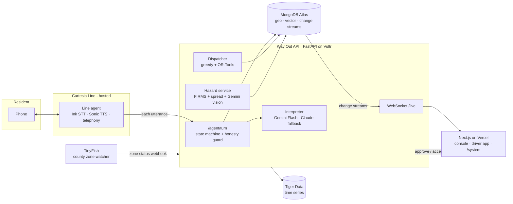

# Way Out

*A way out* is what you need when you're trapped, and it's also the literal road out of the fire. Way Out finds the people who can't leave on their own, and gives each of them a seat in a neighbor's car or an agency van, the way a ride app matches riders and drivers, built for an evacuation.

**Every home called. Every person who can't get out matched to a driver who can reach them. Nobody told help is coming until a driver has said yes.**

Way Out is built for wildfire evacuations. When a zone goes to **SET**, it calls every home in that zone at once and finds the people who can't leave on their own. It plans pickups with volunteer neighbors and agency vans against a live, satellite-fed fire map. It keeps the drivers it sends toward the fire safe, with phone SOS, man-down detection, and "fire closing in" alerts.

> Built at **SunHacks 9.0** (ASU, Nov 14–15, 2026). Inspired by *Standard Response* (Cal Hacks 13.0) and *FireSight* (LA Hacks 2026). All code in this repo was written during the hackathon. See [Credits](#credits).

---

## Contents
1. [The problem](#the-problem)
2. [What Way Out does](#what-way-out-does)
3. [What's new vs. Standard Response and FireSight](#whats-new-vs-standard-response-and-firesight)
4. [Architecture](#architecture)
5. [Tech stack and sponsors](#tech-stack-and-sponsors)
6. [Screens](#screens)
7. [Algorithms](#algorithms)
8. [Environments, branches, deploys](#environments-branches-deploys)
9. [Repo layout](#repo-layout)
10. [Run it locally](#run-it-locally)
11. [Team and timeline](#team-and-timeline)
12. [Demo script](#demo-script)
13. [Priorities (P0 / P1 / P2)](#priorities)
14. [SunHacks rules and prize targets](#sunhacks-rules-and-prize-targets-from-the-opening-slides)
15. [Credits and rules](#credits-and-rules)

---

## The problem

> **Aarya owns this section.** Every number needs a primary source in `docs/story/sources.md` before it goes on a slide.

- In wildfires, the people who die are mostly older adults and people who can't leave on their own. Lahaina (2023), Camp Fire (2018), Eaton (2025). **TODO Aarya:** verify counts and age data from primary sources.
- Disability registries exist, but in a disaster nobody has the staff to call through them in time.
- Arizona this year: the **Pocket Fire** (June 2026) forced evacuations in **Oak Creek Canyon** north of Sedona, and **SR 89A**, the canyon's main road, was closed. That gives us one canyon and one main road out. **TODO Aarya:** InciWeb timeline, number of homes, and census age/disability rates for the canyon (we expect an older population; confirm it).
- **The gap:** 911 dispatch is the bottleneck. Calls queue up. The person in a wheelchair waits in the same line as everyone else. Nothing connects them to the van or the neighbor down the street who could take them.

## What Way Out does

```
Zone goes to SET ─► call every home at once ─► census: who needs help / who can help / who's out
       │                                              │
 (TinyFish watches                                    ▼
  county pages)                      ride requests ─► dispatcher approves plan (1 click)
                                                      │
Satellite + photo fire map ─► deadline per home       ▼
                                          driver accepts on phone ─► resident called back
                                                      │              with driver name + ETA
                                 driver safety: fire-closing-in, SOS, man-down
                                                      │
                     road closes / fire jumps ─► re-plan ─► resident told the truth at once
```

1. **Call everyone, at SET, not GO.** Arizona counties use **Ready, Set, Go**. TinyFish watches the county's evacuation-status pages. The moment our zone moves to SET, the agent (Cartesia voice + Gemini) calls every household in parallel, in English or Spanish.
2. **Build a live census.** Each call fills one record: is everyone able to leave, how many people, mobility (walker, manual or power chair, bedbound), oxygen, pets, car, and how much help getting out. Red means needs a ride, orange means can help a neighbor, green means already out.
3. **Silence is never "safe."** No answer → retry at 2 min → retry at 5 min → text → added to the door-knock list for field crews.
4. **Plan pickups that can actually happen.** The optimizer matches each request to a vehicle with the right seats, wheelchair space, and crew, before that home's fire deadline. A dispatcher approves with one click. Each driver accepts or declines on their phone.
5. **The honesty rule (enforced in code, not in the prompt).** The agent never says help is coming until a driver has accepted. Every sentence about a ride is a fixed template chosen by the request's status.
6. **Close the loop.** When a driver accepts, the resident gets a call back with the driver's name, vehicle, and ETA. If a road closes and the driver can't get through, the resident hears that right away, and a new driver is found.
7. **Protect the drivers.** The driver app shows "Fire 400 m NE, closing in." It flags a route that enters the fire buffer. It sends SOS or MAN DOWN (impact, then stillness) with coordinates to the dispatcher.

<a name="whats-new"></a>
## What's new vs. Standard Response and FireSight

| | Standard Response | FireSight | **Way Out** |
|---|---|---|---|
| When calls start | At the evacuation order (GO) | — | **At SET**, triggered automatically from county pages by TinyFish (demo: our labeled drill page) |
| Fire data | Scripted replay of a past fire | Drone + Gemini vision | **NASA FIRMS satellite detections + Gemini vision on photos** → live deadline per home |
| Who's protected | Residents | Field wearers (smart glasses) | Residents **and the volunteer drivers we send toward the fire**, using phone sensors only, no hardware |
| Duplicate calls | — | — | **Vector-search de-duplication** (one household, three callers → one request) |
| Hazard | Wildfire | Wildfire | **Hazard plug-in** (wildfire now; flood/hurricane use the same pipeline) |

## Architecture



The full walkthrough, with every flow, state machine, deployment, and fallback, is in **[`docs/ARCHITECTURE.md`](docs/ARCHITECTURE.md)**. Read it before your first task.

**Rules every part follows** (details in [`docs/CONTRACT.md`](docs/CONTRACT.md)):
- **One database is the source of truth.** Services never call each other's internals. They read and write MongoDB through the API, and the UI listens on `/live`.
- **The AI only interprets. Code decides.** Gemini turns "it's just me… no wait, my son's here, he can't walk" into record fields. The state machine picks the next question and every status sentence.
- **Only `requests.py` changes a request's status**, and only along the legal transitions.
- **Accept is atomic.** Two phones tap Accept at the same moment: exactly one wins, and the other sees "Assignment changed."

## Tech stack and sponsors

| Layer | Choice | Sponsor prize |
|---|---|---|
| Voice and phone line | **Cartesia Line** (Python SDK, Ink STT, Sonic TTS, managed numbers) | — |
| Live interpretation | **Gemini Flash** (`gemini-3.8-flash`, JSON schema output) | **Gemini** |
| Backup brain + grader | **Claude Sonnet 5.5** as fallback; **Claude Opus 5.5** as the eval judge, both on **Amazon Bedrock** (D1-10) | **Best Use of AWS** (Amazon) |
| Vision | **Gemini** on photos from residents and drivers (smoke, flames, blocked road) | **Gemini** |
| Database | **MongoDB Atlas**: geo queries, Vector Search, change streams | **MongoDB** |
| Time series | **Tiger Data**: vehicle tracks, fire detections, call latency, KPIs | **Tiger Data** |
| Hosting | **Vultr** VM: API (dev / staging / prod containers) + Caddy | **Vultr** |
| Live web data | **TinyFish**: county Ready-Set-Go pages, InciWeb updates | **TinyFish** |
| Fire model | Elliptical spread (Python). Optional MATLAB version for the prize. | **MATLAB** (P2) |
| Volunteer mileage | **Solana** devnet payout when a pickup is confirmed | **Solana** (P2) |
| Domain | **GoDaddy Registry** (via the MLH offer) | **GoDaddy Registry** |
| Frontend | Next.js 15 + Tailwind + shadcn/ui + MapLibre GL + deck.gl, hosted on Vercel | — |
| Dispatch | Python, Google OR-Tools | — |

**Future of Work (JFF Ventures prize).** Way Out turns paratransit drivers, agency van crews and neighbors into an on-call emergency workforce. The AI works the phone bank (200 homes at once), so one dispatcher supervises and approves instead of dialing. Drivers get offers like gig work, see exactly who they're picking up and what help is needed, and get mileage paid (Solana, P2). These are low- and middle-wage workers who get paid, safe, well-briefed work at the moment they're most needed.

## Screens

Design rules: **map-first**. Red means only *fire* or *a person who needs help*. One primary action per screen. Big tap targets on the driver app. Numbers animate, and nothing jumps. Dark UI for a night-time incident. It has to be usable at 3 a.m. by someone who's never seen it.

| Path | Who | What |
|---|---|---|
| `/` | Judges | Kiosk: pick a house on the map, enter your phone number, and Way Out calls you as that resident |
| `/console` | Dispatcher | Live map (fire front, homes colored by status, vehicles with trails, routes). Left: who needs a ride (sorted by deadline). Right: plan to approve, fleet, door-knock list, safety alerts. Keyboard: `A` approve, `J/K` move through the list |
| `/calls` | Dispatcher | Call floor: every live call, its transcript streaming in, the record filling, latency per turn |
| `/driver` | Drivers (phone, PWA) | Uber-style: offer card with countdown → Accept/Decline → turn-by-turn list → "Picked up" swipe. Fire distance banner, SOS (hold), man-down |
| `/system` | Judges | Under the hood: architecture, latency p50/p95, honesty rate, dispatch vs. baseline with ranges, audit trail |
| `/report` | Anyone | Upload a photo of smoke, fire, or a blocked road → Gemini marks it on the map (P2) |
| `/drill` | Demo | A **clearly labeled Way Out drill page** with our test zone's Ready/Set/Go status. TinyFish reads it the same way it reads county pages. It never imitates a real county site |

## Algorithms

| Problem | Method | Where |
|---|---|---|
| Which vehicle picks up whom | **Pickup-and-delivery VRP with time windows and capacities** (Google OR-Tools), re-solved on every change (rolling horizon). **Greedy earliest-deadline-first** is the baseline and the fallback | `api/dispatch/` |
| Deadline per home | Fire arrival from **NASA FIRMS VIIRS** points + wind, using **elliptical (Huygens/FARSITE-style) spread**. Deadline = arrival − 10 min | `api/hazard/spread.py` |
| Duplicate calls | **Embedding entity resolution**: Gemini embeddings + Atlas Vector Search, then a rule check (same address ±50 m) | `api/agent/dedupe.py` |
| Don't promise rescue | **Constitution + judge** (after Anthropic's *Constitutional AI*, Bai et al. 2022): written call-taker principles. Claude Opus grades every agent line. Code templates carry all ride status | `api/agent/honesty.py`, `evals/` |
| Who gets a door-knock first | Transparent score: need × urgency ÷ travel time + aging term (nobody stays last forever) | `api/dispatch/doors.py` |
| Man-down | Impact > threshold *g* (DeviceMotion), then stillness for 10 s → "Are you OK?" → 20 s → MAN DOWN | `web/app/driver/safety.ts` |

## Environments, branches, deploys

| Env | Git branch | Web | API | Database | Who deploys |
|---|---|---|---|---|---|
| **Development** | `develop` (+ local) | `dev.<domain>` (Vercel) | `api-dev.<domain>` (Vultr container) | Atlas `wayout_dev` | Auto on merge to `develop` |
| **Testing / staging** | `staging` | `staging.<domain>` | `api-staging.<domain>` | Atlas `wayout_staging` | Auto on merge `develop → staging` |
| **Production (live app)** | `main` | `app.<domain>` | `api.<domain>` | Atlas `wayout_prod` | Auto on merge `staging → main` (Prem approves) |

- Feature work happens on `feat/<task-id>-<slug>` → PR into `develop`. Every PR runs lint + tests (GitHub Actions). Nobody pushes to `develop`, `staging`, or `main` directly.
- **Releases:** `v0.1` (M1), `v0.2` (M2), `v1.0` (demo). Each is a PR `develop → staging`, then `staging → main`.
- Full rules: [`CONTRIBUTING.md`](CONTRIBUTING.md). Rules for coding agents: [`AGENTS.md`](AGENTS.md).

## Repo layout

```
wayout/
├─ README.md               ← you are here
├─ CONTRIBUTING.md         ← branches, envs, PRs, releases
├─ AGENTS.md               ← rules for Claude Code / Cursor / Codex
├─ docs/
│  ├─ ARCHITECTURE.md      ← how the whole system fits together (start here)
│  ├─ CONTRACT.md          ← DB schema, status machine, API, events  (shared, change with care)
│  ├─ team/                ← one task file per person
│  └─ story/               ← sources, numbers, personas, firefighter notes (Aarya)
├─ api/                    ← FastAPI (Python 3.12)
│  ├─ main.py  core/  models/  requests.py  routes/
│  ├─ agent/   (turn state machine, interpreter, templates, honesty guard, dedupe)
│  ├─ dispatch/ (greedy, ortools, doors, solve loop)
│  ├─ hazard/  (firms, spread, vision)
│  ├─ sim/     (stand-ins: 200 households, drivers, fire clock)
│  └─ tests/
├─ voice/                  ← Cartesia Line agent (thin client → /agent/turn)
├─ web/                    ← Next.js app (console, calls, driver, system, kiosk, report)
├─ evals/                  ← personas, Claude judge, honesty + accuracy results
├─ data/                   ← population.csv, scenario.geojson, personas.json, shelters.json
├─ infra/                  ← docker-compose.yml, Caddyfile, deploy scripts
└─ .github/workflows/      ← ci.yml, deploy.yml
```

## Run it locally

```bash
cp .env.example .env            # fill keys (see below)
# Local MongoDB as a replica set (change streams for /live need one). Or point MONGODB_URI at Atlas.
docker compose -f infra/docker-compose.local.yml up -d   # MONGODB_URI=mongodb://localhost:27017/?directConnection=true
# API: run from the REPO ROOT. The package is `api`, so `api/requests.py` never shadows the `requests` library.
uv sync --project api && uv run --project api uvicorn api.main:app --reload --port 8000   # docs at :8000/docs
# Tests + lint
cd api && uv run ruff check . && uv run pytest -q && cd ..
# Web
cd web && pnpm i && pnpm dev     # http://localhost:3000, NEXT_PUBLIC_API_URL=http://localhost:8000
# Seed a scenario + stand-ins
curl -X POST localhost:8000/sim/seed?scenario=pocket-fire
# Voice agent (Cartesia Line)
cd voice && uv sync && cartesia deploy   # then: cartesia call +1XXXXXXXXXX <agent_id>
```

Endpoints that aren't built yet return **501** with the task ID and owner (e.g. `not implemented yet: D1-02 (Deep)`).

`.env.example`
```
ENV=dev
MONGODB_URI=            # Atlas; DB name comes from ENV
TIGER_DATABASE_URL=
GEMINI_API_KEY=
GEMINI_MODEL=gemini-3.8-flash
ANTHROPIC_API_KEY=
CLAUDE_FALLBACK_MODEL=claude-sonnet-5-5
CLAUDE_JUDGE_MODEL=claude-opus-5-5
CARTESIA_API_KEY=
CARTESIA_AGENT_ID=
CARTESIA_FROM_NUMBER_ID=
FIRMS_MAP_KEY=          # NASA FIRMS
TINYFISH_API_KEY=
PUBLIC_API_URL=
INTERNAL_TOKEN=         # shared secret between Line agent and API
```
**Never commit `.env`.** Secrets live in GitHub Environments and in the Vultr server's env files.

## Team and timeline

| Person | Role | Task file |
|---|---|---|
| **Prem** | Foundation + coordination. Codes 11:10 AM–2 PM, away 2 PM–1 AM, leads integration from 1 AM | [`docs/team/prem.md`](docs/team/prem.md) |
| **Deep** | Resident side: voice agent, interpreter, honesty, calls, dedupe, evals | [`docs/team/deep.md`](docs/team/deep.md) |
| **Yash** | Responder side: console, driver app, dispatch, fire map, stand-ins | [`docs/team/yash.md`](docs/team/yash.md) |
| **Aarya** | Story, data, firefighter interview, deck, video, Devpost | [`docs/team/aarya.md`](docs/team/aarya.md) |

| Time (Sat → Sun) | Milestone |
|---|---|
| 9:00–11:10 AM | Check-in, opening. **No code before 11:10**: read the docs and agree on the contract |
| **11:10 AM** | Hacking starts. Prem creates the repo and pushes these docs |
| **2:00 PM** | **M0 (foundation)**: repo, branches, CI, 3 envs, Atlas, Vultr, contract v1, seed data, a call ringing a phone. Prem hands off |
| **6:00 PM** | **M1 (`v0.1`)**: a real call fills a household record, a request appears on the console map, stand-in households fill the zone |
| **10:00 PM** | **M2 (`v0.2`)**: approve → driver accepts on phone → callback with driver name and ETA. A road closure revokes the ride, the resident is told, a new driver accepts |
| **1:00 AM** | **M3 (feature freeze)**: fire map live (FIRMS + spread), SOS/man-down, dedupe, `/system` with real numbers, staging deployed. Prem returns |
| 1:00–5:00 AM | Integration, bug bash, evals run, `v1.0` to production |
| 5:00–9:00 AM | Demo rehearsal ×3, video recorded, Devpost written |
| **10:30 AM** | **Submit on Devpost (not a draft).** Hard deadline 11:00 AM |
| 12:00–2:00 PM | Project expo |

## Demo script

**3 minutes, real phone, one story.** Full script and Q&A in `docs/story/demo.md` (Aarya).

1. **0:00 Story.** One real person who couldn't get out (Aarya). "The van was ready. Nobody called."
2. **0:20 SET.** The Pocket Fire zone flips to SET on the county page → TinyFish → Way Out starts calling 200 homes. The map lights up.
3. **0:35 The call.** A judge's phone rings. They play **Rosa, 81**. Mid-call they correct themselves: "my husband is here, he's in a power chair." The record changes live. "Is someone coming?" → **"Not yet. You're on the list as high priority. I'll call you back the moment a driver accepts."**
4. **1:05 Plan.** The optimizer gives Rosa to the only van with wheelchair space and two crew. The dispatcher approves (`A`). "Approval isn't a promise, so Rosa hears nothing yet."
5. **1:25 Accept.** A teammate accepts on the driver app → Rosa's phone rings: "A wheelchair van with a two-person crew is 7 minutes away. The driver's name is Luis."
6. **1:45 The change.** The fire jumps SR 89A (satellite + photo report) → the road closes → no route reaches Rosa in time → ride revoked → her phone rings: "Your driver can no longer reach you. You're still at the top of the list." A neighbor uphill who is already leaving accepts. A late tap on the old offer is rejected on screen.
7. **2:15 Driver safety.** The driver's phone is dropped → "Are you OK?" → MAN DOWN on the console with coordinates.
8. **2:30 Proof.** `/system`: on-time pickups vs. the greedy baseline (simulated, with ranges), honesty judge results, latency.
9. **2:50 Close.** One line (Aarya).

## Priorities

- **P0 (must work for the demo):** real call + interpreter + templates + honesty guard · households / requests / assignments with atomic accept · console map + approve · driver app accept → callback · road closure → revoke → reassign · stand-ins (200 homes, drivers) · staging + prod deployed.
- **P1 (makes it win):** NASA FIRMS + spread deadlines · TinyFish SET trigger · SOS / man-down · OR-Tools vs. greedy with ranges · Claude judge evals · dedupe · Tiger Data charts on `/system` · Spanish.
- **P2 (if time):** Gemini photo reports · Solana mileage payouts · MATLAB spread · flood plug-in.

<a name="credits"></a>
## SunHacks rules and prize targets (from the opening slides)

**Rules that can disqualify us:**
- **Submit on Devpost by 11:00 AM Sunday. No late submissions.** Our target: complete by **10:00**, last touch by 10:30.
- **No commits before hacking starts (11:10 AM Sat) or after it ends (11:00 AM Sun).** Our first commit is 1:12 PM Sat ✅. **Code freeze at 10:30 AM Sun; nobody pushes to any branch after 11:00**, not even a typo fix.
- A valid project: follows the MLH Code of Conduct, has a filled-out Devpost, and hasn't been made before (all code written here; see Credits).

**Judging:**
- **3 minutes of demo, then 2 minutes of questions. "Your hack, not your slides, is judged."** The demo opens on the live console and phone. At most one slide (the story), then the product.
- Devpost: fill it as we go, **one editor at a time** (Aarya edits, Prem reviews). A video is optional but recommended (A-10).

**Prizes we go for:**

| Prize | Why we fit | Proof in the demo |
|---|---|---|
| Best Overall (1st/2nd/3rd) | Real problem, real numbers, works live end to end | The whole 3 minutes |
| **Future of Work: JFF Ventures** | Drivers and dispatchers as an AI-assisted emergency workforce (see above) | Driver app offer → accept; one dispatcher approving a 200-home plan |
| **Best Use of AWS: Amazon** | Claude on Amazon Bedrock is the backup brain and the eval judge | `/system`: judge results, provider = Bedrock |
| **Best Use of TinyFish** | A TinyFish agent watches the zone page and starts the calls at SET | Demo step 2: flip the drill page → calls start with no other click |
| MLH sponsor prizes | Gemini, MongoDB Atlas, Tiger Data, Vultr, GoDaddy Registry (Solana and MATLAB are P2) | Tick each one on Devpost |

Not targeted: Best Hardware, Best Gaming, Most Impractical, Best Mascot, and the student-org categories.

## Credits and rules

- Ideas from **Standard Response** (Cal Hacks 13.0: call-every-home census, status-template honesty, atomic accept) and **FireSight** (LA Hacks 2026: Gemini hazard vision, wearer SOS/man-down). **No code was copied.** Both repos have no license, and MLH rules forbid reusing earlier code. We wrote everything here at SunHacks.
- **AI use disclosure:** we used Claude Code / Cursor as coding assistants and Gemini + Claude APIs at runtime. The Devpost write-up says which parts.
- Simulated households, drivers, and fire timelines are **labeled as simulation** on every screen. Fictional people only. No real resident data.
